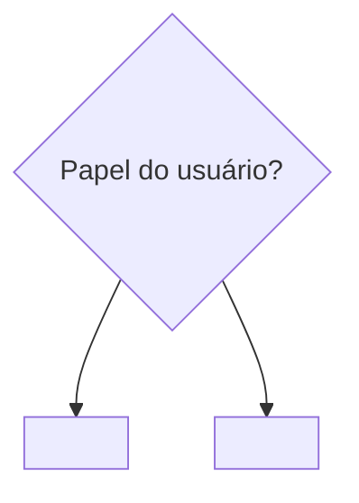
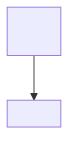

# Modelos

A base vem do projeto calhas: o "Blueprint de Telas", os docs de `mvc-protect-calhas/docs/front/` e as tasks de tela PC-194 a PC-235. Em cima dela entram três coisas que vieram do projeto da usina (`docs/front/09-FLUXO_FIGMA.md`):
- O cabeçalho fixo do prompt. As tasks do calhas perderam a cor e a fonte no caminho e só diziam "seguir o design system (PC-193)", algo que o First Draft não conhece.
- A aprovação com `node-id`.
- A comparação visual.

## 1. Design System Base

Arquivo `docs/front/DESIGN_SYSTEM_BASE.md`:

````markdown
# Design System Base

> Camada 1. Decidido em DD/MM/AAAA, comparando opções reais. Toda Ficha de Tela referencia este doc; nenhuma tela o reescreve.

| Campo | Valor |
|---|---|
| Stack e referência de estilo | <Flutter + Material 3> |
| Cor | <cor-base (seed) #2E6C8E; o Material 3 deriva o resto com ColorScheme.fromSeed()> |
| Fonte | <Inter: 400 no corpo, 500/600 em títulos, 700 em destaques> |
| Temas | <claro; escuro no roadmap> |
| Grid e margens | <unidade de 8dp; margem de 16dp no mobile e 24dp na web> |
| Breakpoints | <Compact < 600dp · Medium 600–840dp · Expanded ≥ 840dp> |
| Componentes base | <botões, campos, cards, app bar e navegação herdam do tema; raio de 8 a 12px> |
| Frames no Figma | <Mobile 390×844 · Web 1440×900> |

## Por que dá para trocar depois

<Como o tema central gera tudo; por que nenhuma tela guarda cor ou fonte própria.>

## Cabeçalho fixo do prompt

Abre todo prompt do First Draft, mobile ou web. Mudou um token acima? Mude aqui também.

```
<o cabeçalho, no formato da seção 4>
```
````

## 2. Fluxo Mestre

Arquivo `docs/front/FLUXO_MESTRE.md`:

````markdown
# Fluxo Mestre de Navegação

> Para onde cada papel vai depois do login, tirado dos guards e decorators de papel do código (`<arquivo do enum de papéis>`).



## Menu por casca

### <Casca A> — `<PAPEL>`
- **<Item do menu>** — <o que faz> (<Epic>)
- **<Item só de um papel>** — **só <PAPEL>** (<Epic>)

## Divergências entre o código e os docs
- <ex.: o doc de papéis lista um papel que o código não tem> → <decisão, com data>
````

A Ficha usa três níveis de variação por papel:
1. **Rota:** o papel decide a casca inicial. Isso é resolvido no login.
2. **Menu:** dentro da mesma casca, alguns itens só aparecem para certos papéis.
3. **Ações na tela:** a tela é a mesma, mas as ações mudam por papel.

## 3. Fluxo por módulo

Arquivo `docs/front/FLUXO_<MODULO>.md`:

````markdown
# Fluxo de <Módulo>

> Telas do módulo (Epic <CHAVE-n>), ancoradas nos endpoints reais de `<src/modulo/>`. O detalhe de cada tela fica na Ficha, no Jira.



## Telas do módulo

| Tela | Endpoint | Campos principais | Entra de → vai para | Regra-chave |
|---|---|---|---|---|
| <Tela> | `<VERBO /rota>` | <campos> | <origem> → <destino> | <regra> |

## Regras de negócio do módulo
- <RNxx: o que muda na tela>

## Pendências do módulo
1. **<tema>** `[TASK CRIADA → <CHAVE>-XX]` | `[RESOLVIDO]` | `[ROADMAP]`: <o que falta e o que foi decidido>
````

## 4. Prompt do First Draft

A fórmula é sempre a mesma, na mesma ordem. É isso que faz o First Draft seguir o app em vez de inventar um layout:

```
[cabeçalho fixo do Design System] + [tipo de tela] + [variante] + [objetivo] + [campos, na ordem da Ficha]
+ [regras que aparecem na tela] + [ações] + [estados a desenhar]
```

Cada tela tem um prompt por variante. Objetivo, campos e regras são os mesmos nos dois; só o layout muda.

**Cabeçalho fixo** (exemplo do calhas, com os tokens que as tasks tinham perdido):

```
App: MVC Calhas, app de gestão de imóveis e manutenção de calhas. Interface em português (Brasil).
Estilo: Material 3 com cor-base #2E6C8E (paleta derivada da seed, ColorScheme.fromSeed) e fonte Inter
(400 no corpo, 500/600 nos títulos). Grid de 8dp, margem de 16dp no mobile e 24dp na web, cantos de 8 a 12px.
Tema claro. Use só componentes do design system: botões, campos, cards, app bar e navegação herdam da paleta,
sem nenhuma cor fora dela. Erro, aviso e sucesso sempre com texto, nunca só com cor.
```

**Corpo do prompt** (exemplo: a PC-194, Cadastro de Imóvel, variante Mobile):

```
Crie uma tela de formulário mobile (Compact, < 600dp, frame 390×844).
Layout em etapas (stepper), uma coluna, com navegação inferior "Voltar / Avançar".
Objetivo: cadastrar um novo imóvel vinculado a um plano de pagamento.

Campos, nesta ordem:
1. Tipo de imóvel — seletor: Residencial, Comercial, Industrial, Agrícola, Uso misto
2. Área construída em m² — campo numérico
3. Localização — botão "Usar minha localização" + endereço (rua, número, complemento opcional, cidade, estado, CEP, país)
4. Plano — seletor com os planos do usuário
5. Forma de pagamento — seletor: Boleto, Pix, Cartão de crédito
   → se Cartão de crédito, mostrar o subformulário com os dados do cartão

Aviso fixo acima do botão de confirmar: "A primeira mensalidade é cobrada no ato da contratação."

Estados a desenhar: carregando a lista de planos, enviando, erro de validação por campo, erro de rede, sucesso.
```

## 5. Ficha de Tela

É a descrição da task.
- **Título:** `Tela: <Nome> — Mobile + Web`.
- **Tipo e pai:** `Tarefa`, filha da Epic do módulo.
- **Labels:** `figma`, `frontend`, `mobile`, `web`, a stack (`flutter`, `next`) e o domínio.

````markdown
**Módulo / Épico:** <Módulo> (<CHAVE-n>)
**Depende de:** <task do Design System> · <tasks de backend, se houver>

**Prioridade:** <nível>. <motivo>

**Objetivo**
<O que a tela resolve, em 1 frase.>

**Fluxo de navegação**
Entra de <origem> (<ação>) → sucesso: <destino> · erro: <o que acontece> · cancelar: <destino>.

**Variantes**
* Mobile — <layout>
* Web — <layout>
* Tablet — sem desenho próprio (reflow das duas) | <desenho próprio, porque a tela muda de forma>

**Estados**
<carregando · vazio · enviando · erro de validação por campo · erro de rede · sucesso · <os da tela>>

**Papéis & variações**
<nível 1, 2 ou 3 (ver o Fluxo Mestre) e quem vê o quê. Ex.: "Só CLIENT; OWNER e EMPLOYEE não veem esta tela.">

**Regras de negócio**
* <RNxx: como aparece na tela>

**Dados consumidos**
`<VERBO /rota>` (`<RequestDto>`) → `<ResponseDto>` · `<outras chamadas>`

**Campos (espelham o DTO)**

| Campo (DTO) | Componente | Obrigatório | Observação |
|---|---|---|---|
| <campo> | <componente e opções> | Sim / Não / Condicional | <validação, dependência> |

**Textos**
Título: "<...>" · Botões: "<...>" · Erros: "<...>" · Vazio: "<...>" · Sucesso: "<...>"

**Decisões** (tomadas em DD/MM/AAAA)
1. **<tema>:** <decisão>

**Prompt — Figma First Draft (Mobile)**
```
<cabeçalho fixo do Design System>

<corpo do prompt, variante Mobile>
```

**Prompt — Figma First Draft (Web)**
```
<cabeçalho fixo do Design System>

<corpo do prompt, variante Web>
```

**Checklist antes de colar no First Draft**
* [ ] Anexar um print de referência de estilo (uma tela já aprovada do mesmo módulo, se houver)
* [ ] Textos iguais aos da seção Textos
* [ ] Frame no tamanho do Design System (<390×844> mobile / <1440×900> web)
* [ ] Nome dos frames: `Tela/<Módulo>/<Tela>/<Mobile|Web>`, mais `/<Tema>` se houver mais de um tema e `/<estado>` para cada estado

**Ref:** `docs/front/FLUXO_<MODULO>.md`, `docs/front/FLUXO_MESTRE.md`, `docs/front/DESIGN_SYSTEM_BASE.md`
````

## 6. Registro da aprovação

É um comentário na task, feito quando o usuário aprova o desenho:

```markdown
**Desenho aprovado em DD/MM/AAAA**
Arquivo: <link do Figma>

| Quadro | node-id |
|---|---|
| Tela/Imoveis/Cadastro/Mobile | 12:345 |
| Tela/Imoveis/Cadastro/Web | 12:400 |

Ajustes pedidos na aprovação: <lista, ou "nenhum">
```

## 7. Implementação e fechamento da tela

Ficam na skill `figma-para-codigo`: o checklist por tela, o mapa de tokens e o bloco de fechamento, nas seções 4 a 6 do `references/modelos.md` dela.
